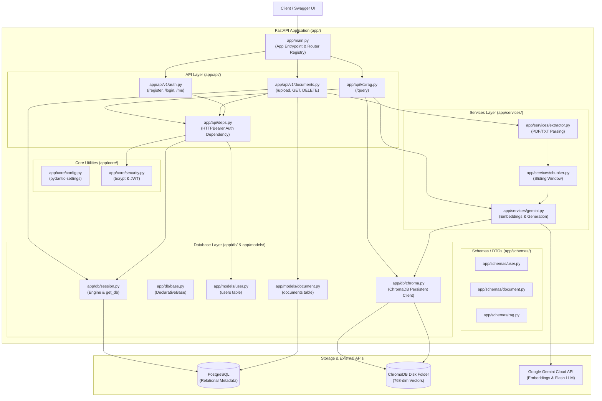

# Production RAG Application - Complete Architecture & Codebase Guide

This document provides a comprehensive, production-grade architectural breakdown of all files in this project. It outlines the exact responsibility, inputs, outputs, and design rationale for every single file.

---

## 📁 System Architecture Overview



---

## 🗂️ File-by-File Breakdown

### 1. Root Configuration & Dependencies

| File | Purpose & Responsibilities |
|---|---|
| [requirements.txt](file:///c:/Coding/Production-Rag/requirements.txt) | **Dependency Manifest**: Pins exact production versions for FastAPI, Uvicorn, SQLAlchemy 2.0, Alembic, Passlib, Bcrypt, Python-JOSE, PyPDF, ChromaDB, and Google-GenAI. |
| [.gitignore](file:///c:/Coding/Production-Rag/.gitignore) | **Git Ignore Rules**: Excludes `.env` secrets, `venv/`, compiled bytecode, local `chroma_db/` persistent files, and IDE caches from Git. |
| [.env](file:///c:/Coding/Production-Rag/.env) | **Active Environment Secrets**: Contains real local PostgreSQL credentials (with URL-encoded passwords), JWT secret keys, and the active `GEMINI_API_KEY`. (Never committed to public version control). |
| [.env.example](file:///c:/Coding/Production-Rag/.env.example) | **Environment Template**: Clean template for other developers and CI/CD pipelines showing required environment variables and sensible defaults. |
| [alembic.ini](file:///c:/Coding/Production-Rag/alembic.ini) | **Alembic Engine Configuration**: Controls script location (`alembic/`), console logging formatters, and migration file naming rules. |

---

### 2. Database Migrations (`alembic/`)

| File | Purpose & Responsibilities |
|---|---|
| [alembic/env.py](file:///c:/Coding/Production-Rag/alembic/env.py) | **Migration Runtime Harness**: Dynamically injects `settings.DATABASE_URL` into Alembic, imports all SQLAlchemy models to register them with `Base.metadata`, and provides online/offline database migration execution. |
| [alembic/script.py.mako](file:///c:/Coding/Production-Rag/alembic/script.py.mako) | **Migration Template**: Jinja/Mako template used whenever `alembic revision` generates a new Python migration script. |
| [alembic/versions/001_create_users_table.py](file:///c:/Coding/Production-Rag/alembic/versions/001_create_users_table.py) | **Users Migration**: Creates the `users` table with UUID primary key, indexed unique `email`, `hashed_password`, and UTC `created_at`. Includes full `upgrade()` and `downgrade()` methods. |
| [alembic/versions/002_create_documents_table.py](file:///c:/Coding/Production-Rag/alembic/versions/002_create_documents_table.py) | **Documents Migration**: Creates the `documents` table linked to `users.id` via Foreign Key with `CASCADE` delete, status column (`processing`, `ready`, `failed`), `chunk_count`, and created timestamp. |
| [alembic/versions/003_create_chat_history_tables.py](file:///c:/Coding/Production-Rag/alembic/versions/003_create_chat_history_tables.py) | **Chat History Migration**: Creates the `conversations` and `messages` tables with cascading foreign keys, JSON source storage, and timestamps. |

---

### 3. Application Core (`app/core/`)

| File | Purpose & Responsibilities |
|---|---|
| [app/core/config.py](file:///c:/Coding/Production-Rag/app/core/config.py) | **Centralized Settings**: Uses `pydantic-settings` to parse and validate `.env` variables at application boot. Exposes a typed singleton `settings` object (`settings.DATABASE_URL`, `settings.GEMINI_API_KEY`, `settings.LLM_MODEL`). Prevents the app from starting if any required secret is missing. |
| [app/core/security.py](file:///c:/Coding/Production-Rag/app/core/security.py) | **Cryptography & Token Logic**: Configures `passlib.context.CryptContext` with `bcrypt` for one-way salted password hashing (`get_password_hash`, `verify_password`). Uses `jose.jwt` to sign and encode stateless JWT tokens (`create_access_token`) containing subject ID and expiration claims. |

---

### 4. Database Setup & Vector Store (`app/db/`)

| File | Purpose & Responsibilities |
|---|---|
| [app/db/base.py](file:///c:/Coding/Production-Rag/app/db/base.py) | **Declarative Base**: Declares `class Base(DeclarativeBase)` using SQLAlchemy 2.0 modern declarative mapping. Maintains the unified catalog of all relational tables and columns. |
| [app/db/session.py](file:///c:/Coding/Production-Rag/app/db/session.py) | **PostgreSQL Connection Pool**: Initializes SQLAlchemy `engine` with `pool_pre_ping=True` (resilient auto-reconnects). Creates the `SessionLocal` factory. Defines `get_db()`, a FastAPI dependency that yields a database transaction per request and guarantees session closure in a `finally:` block. |
| [app/db/chroma.py](file:///c:/Coding/Production-Rag/app/db/chroma.py) | **ChromaDB Vector Store Adapter**: Configures `chromadb.PersistentClient` targeting `./chroma_db` with cosine similarity (`hnsw:space: cosine`). Implements `add_chunks_to_vector_db` (stores chunks, precomputed 768-dim embeddings, and metadata), `delete_document_from_vector_db` (cascading vector purge), and `query_vector_db` (retrieves nearest neighbors strictly filtered by `user_id`). |

---

### 5. Relational Domain Models (`app/models/`)

| File | Purpose & Responsibilities |
|---|---|
| [app/models/user.py](file:///c:/Coding/Production-Rag/app/models/user.py) | **User Entity**: SQLAlchemy 2.0 model for the `users` table. Defines UUID primary key (`uuid.uuid4`), unique indexed `email`, `hashed_password`, `created_at`, and a one-to-many relationship (`documents`) with `cascade="all, delete-orphan"`. |
| [app/models/document.py](file:///c:/Coding/Production-Rag/app/models/document.py) | **Document Entity**: SQLAlchemy 2.0 model for the `documents` table. Defines `DocumentStatus` enum (`processing`, `ready`, `failed`), `user_id` foreign key with index, `filename`, `chunk_count`, and `created_at`. Back-populates `user`. |
| [app/models/conversation.py](file:///c:/Coding/Production-Rag/app/models/conversation.py) | **Conversation & Message Entities**: Models for `conversations` (user-scoped threads) and `messages` (ordered turns with `role`, `content`, and JSON `sources`). |

---

### 6. Data Transfer Objects / Schemas (`app/schemas/`)

| File | Purpose & Responsibilities |
|---|---|
| [app/schemas/user.py](file:///c:/Coding/Production-Rag/app/schemas/user.py) | **Auth DTOs**: Pydantic models for user operations: `UserCreate` (email, min 6-char password), `LoginRequest` (email, password), `Token` (access_token, token_type), and `UserResponse` (id, email, created_at - strictly omitting password hash for data privacy). |
| [app/schemas/document.py](file:///c:/Coding/Production-Rag/app/schemas/document.py) | **Document DTOs**: `DocumentResponse` model with `from_attributes=True` for serializing SQLAlchemy `Document` rows to JSON. |
| [app/schemas/conversation.py](file:///c:/Coding/Production-Rag/app/schemas/conversation.py) | **Conversation DTOs**: `ConversationCreate`, `ConversationResponse` (summary for sidebar), `ConversationDetailResponse` (with messages array), `ChatRequest`, and `ChatResponse`. |
| [app/schemas/rag.py](file:///c:/Coding/Production-Rag/app/schemas/rag.py) | **RAG Query DTOs**: `QueryRequest` (question string, top_k parameter), `SourceItem` (filename, page, chunk text, chunk index), and `QueryResponse` (answer, list of sources). |

---

### 7. Core Ingestion & AI Services (`app/services/`)

| File | Purpose & Responsibilities |
|---|---|
| [app/services/extractor.py](file:///c:/Coding/Production-Rag/app/services/extractor.py) | **File Text Extractor**: Pure Python parser using `pypdf` and stream I/O. Supports `.pdf` and `.txt`. Preserves 1-based `page_number` for each extracted page so downstream citations can accurately cite pages. Rejects scanned/empty files early. |
| [app/services/chunker.py](file:///c:/Coding/Production-Rag/app/services/chunker.py) | **Text Chunker**: Overlapping sliding-window chunker (default: 800-char chunk size, 100-char overlap). Preserves `page_number`, assigns sequential `chunk_index`, and prevents trailing duplicate sliver slices. |
| [app/services/gemini.py](file:///c:/Coding/Production-Rag/app/services/gemini.py) | **Google GenAI Client Wrapper**: Uses the official `google-genai` SDK. Implements `embed_texts` (768-dim embeddings in batches of 10 with `RETRIEVAL_DOCUMENT`), `embed_query` (with `RETRIEVAL_QUERY`), and `generate_rag_answer` (using `gemini-2.5-flash`). Wrapped in exponential backoff retry to handle free-tier API rate limits. |

---

### 8. API Layer & Endpoints (`app/api/`)

| File | Purpose & Responsibilities |
|---|---|
| [app/api/deps.py](file:///c:/Coding/Production-Rag/app/api/deps.py) | **Authentication Dependency**: Uses FastAPI's `HTTPBearer` to extract the Bearer token from the `Authorization` header. Decodes JWT, validates claims, checks user existence in PostgreSQL, and injects `current_user: User` into protected routes. |
| [app/api/v1/auth.py](file:///c:/Coding/Production-Rag/app/api/v1/auth.py) | **Auth Router**: Endpoints: `POST /api/v1/auth/register` (creates user, bcrypt hash), `POST /api/v1/auth/login` (verifies credentials, issues JWT), and `GET /api/v1/auth/me` (returns current user profile). |
| [app/api/v1/documents.py](file:///c:/Coding/Production-Rag/app/api/v1/documents.py) | **Document Management Router**: `POST /api/v1/documents/upload` (orchestrates upload -> extract -> chunk -> embed -> store), `GET /api/v1/documents` (lists user documents with case-insensitive `?filename=` search via PostgreSQL `ILIKE`), and `DELETE /api/v1/documents/{id}` (dual-store deletion: purges vectors from ChromaDB and row from PostgreSQL). |
| [app/api/v1/conversations.py](file:///c:/Coding/Production-Rag/app/api/v1/conversations.py) | **Conversation Management & Multi-Turn Chat Router**: `POST /conversations` (create thread), `GET /conversations` (list threads), `GET /conversations/{id}` (fetch thread with full history), `DELETE /conversations/{id}` (cascading delete), and `POST /conversations/{id}/messages` (multi-turn conversational RAG). |
| [app/api/v1/rag.py](file:///c:/Coding/Production-Rag/app/api/v1/rag.py) | **RAG Query Router**: `POST /api/v1/rag/query`: Embeds the user question (768 dims), queries ChromaDB strictly scoped to `user_id`, formats retrieved chunks with filename and page citations, prompts Gemini Flash, and returns the grounded answer with citations. |

---

### 9. Application Entrypoint

| File | Purpose & Responsibilities |
|---|---|
| [app/main.py](file:///c:/Coding/Production-Rag/app/main.py) | **FastAPI Application Entrypoint**: Initializes the `FastAPI` instance with title and metadata. Registers all sub-routers (`auth_router`, `documents_router`, `rag_router`) under the `/api/v1` prefix. Exposes a root `/health` check route. |

---

## 🚀 How to Run and Verify the Entire Pipeline

### 1. Database Migrations
```bash
alembic upgrade head
```

### 2. Start Application Server
```bash
uvicorn app.main:app --reload
```

### 3. Interactive Documentation
Visit **`http://127.0.0.1:8000/docs`** to register, authorize with JWT, upload PDF/TXT documents, and ask questions through the `/api/v1/rag/query` endpoint.
